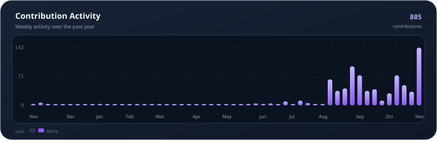
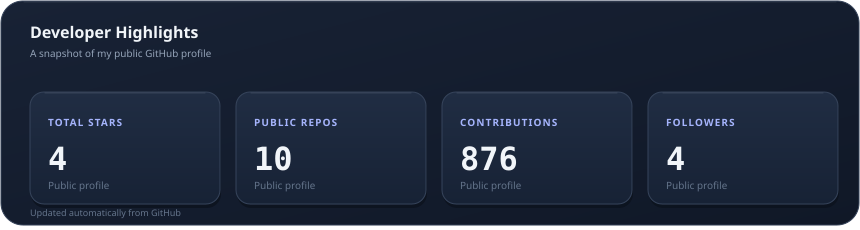

# Rahul Pandiyan

 

  

---

## About

I'm a Computer Science student and developer passionate about building practical software and turning ideas into real products.

I enjoy working across the stack, designing backend systems, exploring AI/ML, and creating applications that solve real-world problems.

- Building full-stack applications and developer tools
- Exploring AI/ML and intelligent software
- Interested in backend engineering and scalable APIs
- Focused on learning, building, and shipping

---

## Selected projects

| Project | Description |
|:--|:--|
| **VTUSync** | An academic technology ecosystem built to simplify the VTU student experience |
| **SafeResale** | An AI-powered second-hand marketplace with product verification |
| **VPlan** | A smart timetable generator for organizing schedules |
| **ResuSync** | An AI-powered resume creation platform |

[Explore all repositories](https://github.com/rahulpandiyan?tab=repositories)

---

## Tech stack

### Languages

### Frontend and mobile

### Backend and frameworks

### Databases and cloud

### AI and tools

---

## Contribution activity

## Contribution snake

---

## GitHub statistics

 

---

## Developer highlights

---

## A thought to take with you

---

## Connect

  

Thanks for visiting. Keep building.

